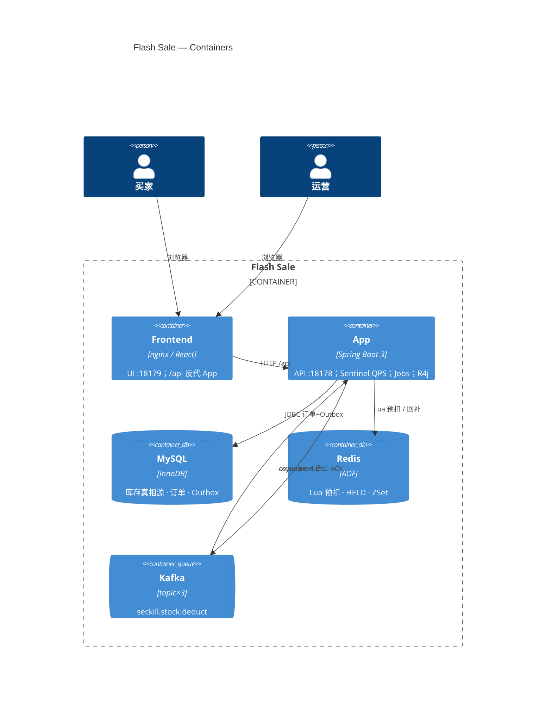
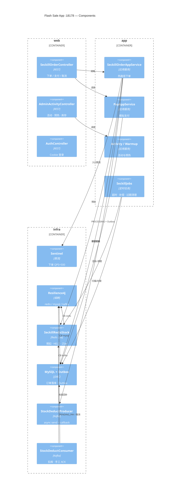
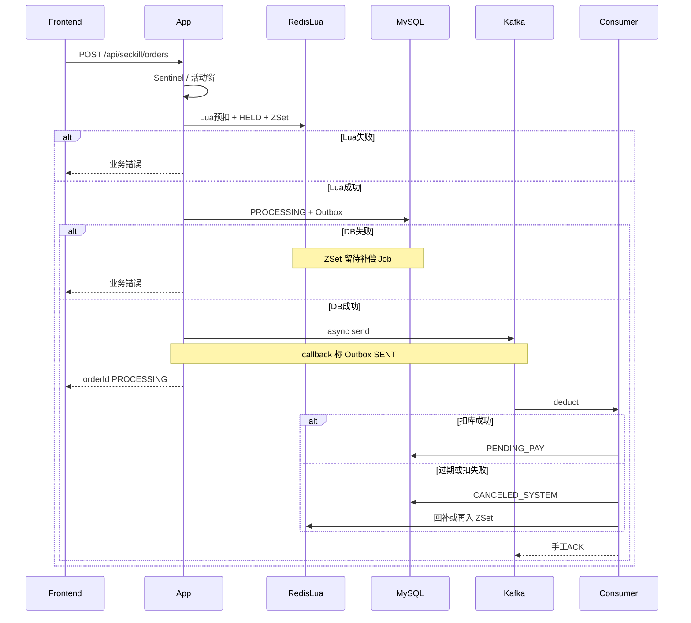
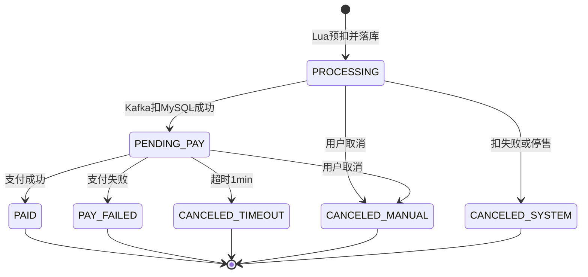
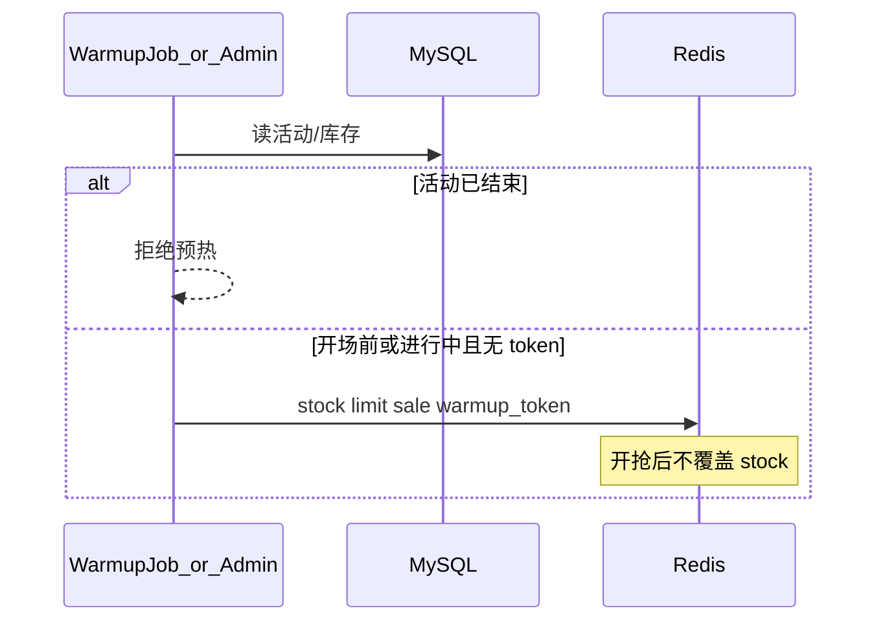
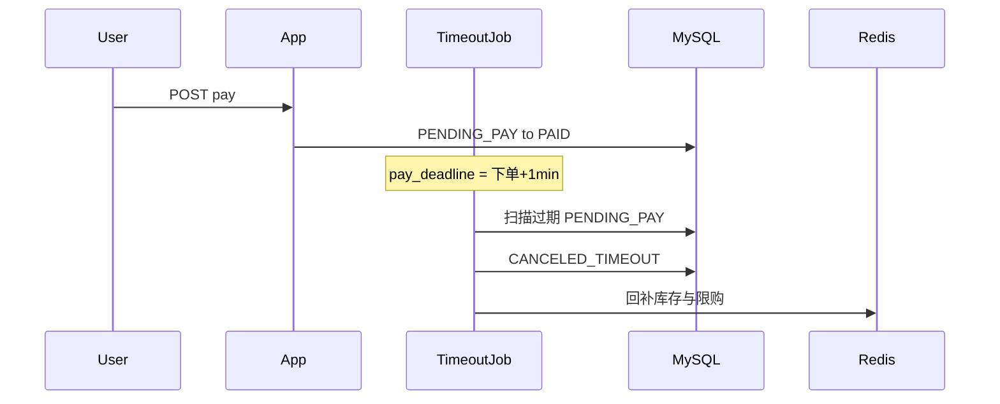
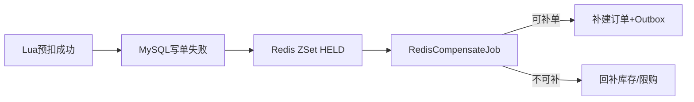
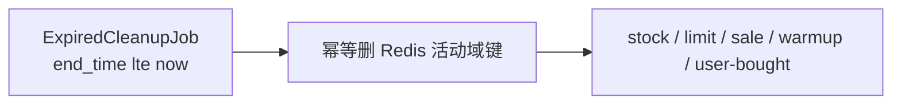

# Presence Flash Sale MVP

单机 Docker（约 2C6G）商品闪购演示。Sentinel 默认 **QPS=500**（`SECKILL_QPS`）。支付窗默认 **1 分钟**（`PAY_WINDOW_MINUTES` / `seckill.pay-window-minutes`），便于超时验收。

**本会话完整演进纪要**（需求 → Plan → 实现/压测/前端/端口）：[`docs/session-export-2026-11-18.md`](docs/session-export-2026-11-18.md)。

## 架构概述

Lua 预扣 → MySQL 订单+Outbox → Kafka **异步**落库；Sentinel QPS=500；支付窗 1min。FE `18179` → App `18178`。C4：Container + Component。

### Container（容器）



### Component（App 组件）



### 抢购核心时序



### 订单状态机



乐观锁 `version`；取消类幂等回补库存 + 回滚限购。

### 预热



### 支付超时



### Redis 预扣 ZSet 补偿



工作队列在 Redis ZSet；MySQL `redis_compensate_log` 仅审计。

### 过期清理



## 快速启动

```bash
# 需要：Docker（或 Colima）、jq（验收脚本）
./scripts/start.sh
```

未安装 Docker 时脚本会提示安装；若已装 Colima 会自动 `colima start --cpu 2 --memory 6`。

| 组件 | 地址 | 内存约 |
|------|------|--------|
| UI (nginx) | http://localhost:18179 （`/api` → app） | ≤64MB |
| App | http://localhost:18178 | 4G（`-Xmx3g`） |
| MySQL | 3306 / `seckill`/`seckill` | ≤768MB |
| Redis | 6379 AOF | ≤320MB |
| Kafka | 9092 topic `seckill.stock.deduct`×3 | ≤768MB |

本地前端开发（可选，不走 Compose）：

```bash
cd frontend && npm install && npm run dev
# http://localhost:18179 代理 /api → 18178
```

### 前端页面

| 页面 | URL | 说明 |
|------|-----|------|
| 用户闪购 | http://localhost:18179/ | 登录 / 退出、按活动 ID + SKU ID 抢购、订单支付/取消 |
| 活动管理 | http://localhost:18179/admin | 创建活动、分页列表/删除、详情（MySQL+Redis 库存）、预热、运维模拟抢单面板 |

品牌展示为 **Flash Sale**（界面不使用 “Seckill”）。

## 打开前端验收

1. 打开 http://localhost:18179/ ：点击 **登录**，刷新页面后仍保持登录（Cookie `seckill_uid`）；**退出** 后会话与订单列表清空。
2. 在管理页 http://localhost:18179/admin 创建活动（开始时间可设为过去）、**手动预热**，记下 `activityId` / `skuId`。
3. 回到用户页，填写活动 ID + SKU ID，点击 **立即抢购**（每次点击生成新 `requestId`，请求进行中按钮禁用）。
4. 订单列表状态为中文（处理中 / 待支付 / 已支付 / 已取消 / 超时取消等）；待支付可 **支付** 或 **取消**。
5. 管理页：**活动列表**（分页 / 删除）、点选查详情（含 **Redis 库存** 与预热状态）并 **刷新**；已预热时禁用预热按钮；**运维压测面板** 必填活动 ID，按「并发数 × 每人购买次数」**模拟抢单**。
6. **支付超时**：未支付订单约 **1 分钟**后由 Job 超时取消并回补库存。
7. **Sentinel**：默认 QPS=500；超限返回业务码 `RATE_LIMITED`（非 500）。

## 演示 / 验收 / 压测

```bash
./scripts/demo.sh                 # 主流程到 PAID
./scripts/accept.sh               # 健康+主流程+幂等+库存不足+未开始
./scripts/bench-seckill.sh        # 默认 CONCURRENCY=10000 / PARALLEL=500 / STOCK=100
# Sentinel QPS=500：建议 PARALLEL≤500；压更高可显式覆盖
CONCURRENCY=500 PARALLEL=500 STOCK=100 ./scripts/bench-seckill.sh
./scripts/bench-loop.sh           # 最多 10 轮；默认 PARALLEL=500，SECKILL_QPS hint=500
```

HTTP 集合（与下方 curl 对齐）：[`scripts/demo.http`](scripts/demo.http)。知识库：[`docs/requirements/`](docs/requirements/)。

## Demo HTTP APIs（curl）

Cookie 登录；也可用 `-H 'X-User-Id: <id>'` 代替 `-b`。

### 登录 / 当前用户 / 登出

```bash
curl -c /tmp/seckill.jar -X POST http://localhost:18178/api/auth/login \
  -H 'Content-Type: application/json' -d '{}'

curl -b /tmp/seckill.jar http://localhost:18178/api/auth/me

curl -b /tmp/seckill.jar -c /tmp/seckill.jar -X POST http://localhost:18178/api/auth/logout \
  -H 'Content-Type: application/json' -d '{}'
```

### 创建活动

```bash
curl -b /tmp/seckill.jar -X POST http://localhost:18178/api/admin/activities \
  -H 'Content-Type: application/json' \
  -d '{
    "name":"Demo",
    "startTime":"2026-11-18T00:00:00",
    "endTime":"2026-12-31T23:59:59",
    "skuId":1001,
    "skuName":"SKU-1001",
    "totalStock":10,
    "perUserLimit":1,
    "unitPriceCent":9900
  }'
# → data.activityId
```

### 活动列表（分页）

```bash
curl -b /tmp/seckill.jar 'http://localhost:18178/api/admin/activities?page=1&size=20'
# → data: { items, total, page, size }；兼容旧参数 limit（等价 page=1&size=limit）
```

### 删除活动（软删除 / 下架；进行中拒绝）

```bash
curl -b /tmp/seckill.jar -X DELETE http://localhost:18178/api/admin/activities/1
```

### 预热

```bash
curl -b /tmp/seckill.jar -X POST http://localhost:18178/api/admin/activities/1/warmup
```

### 查运营库存（MySQL + Redis）

```bash
curl -b /tmp/seckill.jar http://localhost:18178/api/admin/activities/1/stock
# → availableStock(MySQL) + redisStock / warmed / redisSaleEnabled
```

### 下单

```bash
curl -b /tmp/seckill.jar -X POST http://localhost:18178/api/seckill/orders \
  -H 'Content-Type: application/json' \
  -d '{"activityId":1,"skuId":1001,"requestId":"req-1","qty":1}'
# → data.orderId（多为 PROCESSING，稍后 PENDING_PAY）
```

### 订单详情 / 列表

```bash
curl -b /tmp/seckill.jar http://localhost:18178/api/seckill/orders/1
curl -b /tmp/seckill.jar http://localhost:18178/api/seckill/orders
```

### 支付 / 回调 / 支付状态

```bash
# 模拟支付（创建支付单并走成功回调 → PAID）
curl -b /tmp/seckill.jar -X POST http://localhost:18178/api/seckill/orders/1/pay \
  -H 'Content-Type: application/json' -d '{}'

# 模拟支付回调（可不登录；payTradeNo 来自 pay 响应）
curl -X POST http://localhost:18178/api/seckill/pay/callback \
  -H 'Content-Type: application/json' \
  -d '{"payTradeNo":"MOCK...","success":true}'

curl -b /tmp/seckill.jar http://localhost:18178/api/seckill/orders/1/pay-status
```

### 取消

```bash
curl -b /tmp/seckill.jar -X POST http://localhost:18178/api/seckill/orders/1/cancel
```

### 库存不足（小库存 + 第二用户）

```bash
# 1) 登录用户 A，创建 totalStock=1，warmup，等开抢后下单成功
curl -c /tmp/u1.jar -X POST http://localhost:18178/api/auth/login -H 'Content-Type: application/json' -d '{}'
# create activity with "totalStock":1 … warmup … place order as u1

# 2) 登录用户 B，同一活动再下单 → code 1003 STOCK_INSUFFICIENT（或 1013 SALE_DISABLED）
curl -c /tmp/u2.jar -X POST http://localhost:18178/api/auth/login -H 'Content-Type: application/json' -d '{}'
curl -b /tmp/u2.jar -X POST http://localhost:18178/api/seckill/orders \
  -H 'Content-Type: application/json' \
  -d '{"activityId":1,"skuId":1001,"requestId":"u2-req","qty":1}'
```

完整脚本：`./scripts/accept-stock-insufficient.sh`。

### 重复下单（同 userId + requestId）

```bash
RID="idem-$(uuidgen)"
curl -b /tmp/seckill.jar -X POST http://localhost:18178/api/seckill/orders \
  -H 'Content-Type: application/json' \
  -d "{\"activityId\":1,\"skuId\":1001,\"requestId\":\"$RID\",\"qty\":1}"
# 再发一次相同 body → 同一 orderId（code 0）或 IDEMPOTENT_REPLAY(1005)，仅一笔订单
curl -b /tmp/seckill.jar -X POST http://localhost:18178/api/seckill/orders \
  -H 'Content-Type: application/json' \
  -d "{\"activityId\":1,\"skuId\":1001,\"requestId\":\"$RID\",\"qty\":1}"
```

完整脚本：`./scripts/accept-idempotent.sh`。

### 活动未开始

```bash
# create 时 startTime 设为未来（如 +10min），warmup 后立刻下单 → code 1001 ACTIVITY_NOT_STARTED
curl -b /tmp/seckill.jar -X POST http://localhost:18178/api/seckill/orders \
  -H 'Content-Type: application/json' \
  -d '{"activityId":1,"skuId":1001,"requestId":"early-1","qty":1}'
```

完整脚本：`./scripts/accept-activity-not-started.sh`。

统一响应：`{ "code": 0, "message": "成功", "data": ... }`（失败时 `code` 为业务码）。详见 [`docs/requirements/06-api-contract.md`](docs/requirements/06-api-contract.md)。

## 仓库结构

```
backend/          Spring Boot 3 + JDK21 Maven 多模块
frontend/         React + TS (Vite) — 用户闪购 / 管理端
docker/           Compose + MySQL init + Redis AOF + Kafka + frontend nginx
scripts/          start / demo / accept* / bench* / demo.http
docs/requirements/ 知识库
docs/session-export-2026-11-18.md  本会话导出纪要
```

## 已知限制（MVP）

- **单机**：无多实例互斥领取待补偿 ZSet；库存上限 **≤1000**；**售中不可改库存**。
- **登录**：极简 Cookie（`seckill_uid`）/ 可选 `X-User-Id`；无真实鉴权与管理权限。
- **支付**：模拟支付；支付窗默认 1 分钟。
- **Sentinel**：默认 QPS=500；超限返回业务码（非 HTTP 500）。
- **依赖熔断**：Redis / MySQL / Kafka 不可用均熔断并停止新秒杀流量（业务错误码，非 500）；不做无 Kafka 软接单。
- **停售**：扣库失败事件驱动 `sale_enabled=0`；无停售巡检轮询（有活动过期 Redis 清理 Job）。
- **活动时间**：已结束不可预热/下单；开场前可预热、不可下单。

## 可扩展（Backlog）

Kafka 软降级、停售巡检、依赖半开自动恢复、库存分桶、背压监控、完整对账报表。见 [`docs/requirements/09-iteration-backlog.md`](docs/requirements/09-iteration-backlog.md)。
